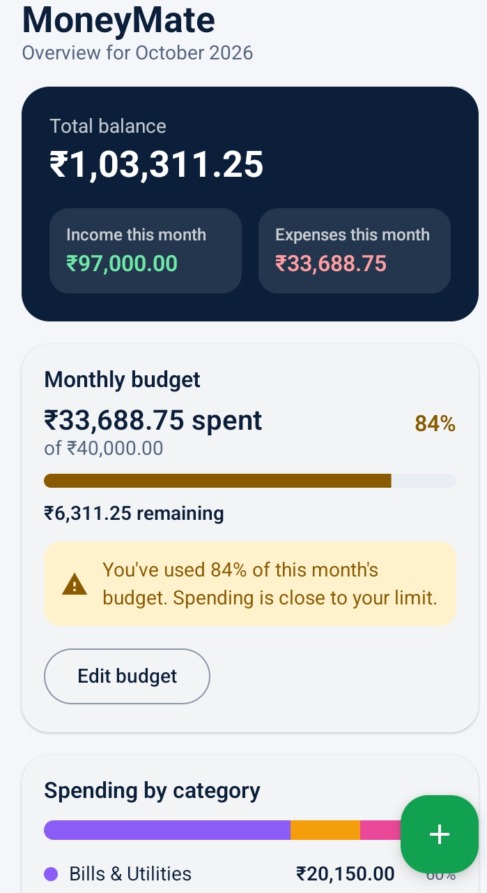
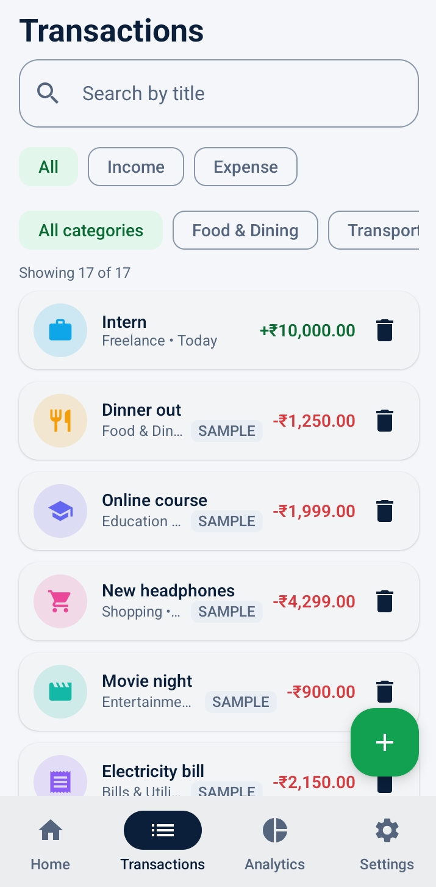
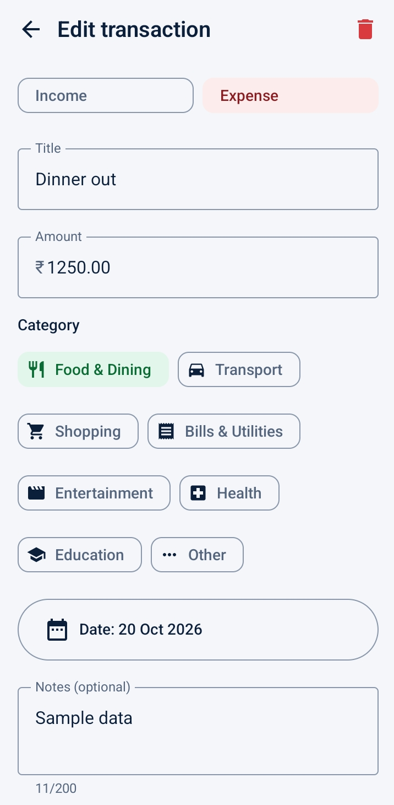
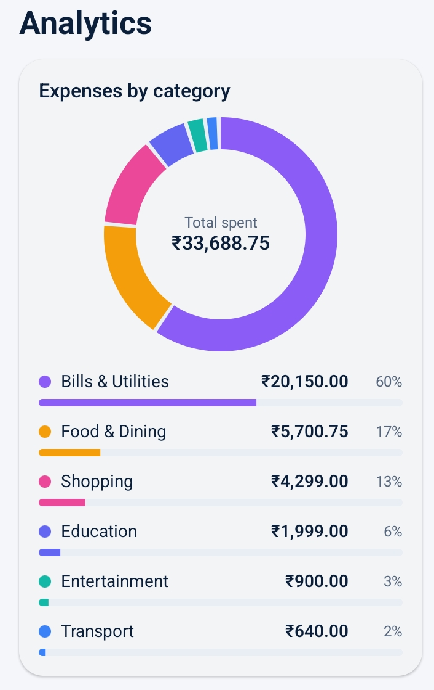
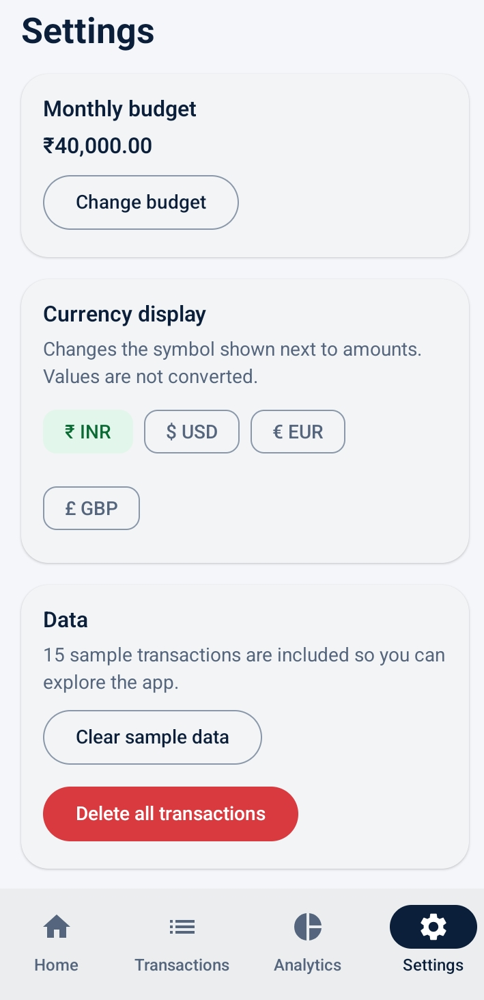

# MoneyMate — Personal Finance Manager

<p align="center">
  
  
  
  
  
  
</p>

A native Android application for tracking income and expenses, setting a monthly budget, and understanding where your money goes. Built with **Kotlin**, **Jetpack Compose**, **Room Database**, and **Clean MVVM Architecture** with Unidirectional Data Flow (UDF).

> **Disclaimer:** This is an independent portfolio project. It is **not** an official Moneyview product and is not affiliated with or endorsed by Moneyview. It uses no Moneyview branding.

---

## 📸 App Screenshots

<div align="center">

| Dashboard | Transactions | Add / Edit Transaction |
| :---: | :---: | :---: |
|  |  |  |
| **Dashboard**<br>Total net balance, income/expense summaries, 80%/100% budget alerts, and recent transactions | **Transactions**<br>Real-time title search, category filter pills, type toggle, and full deletion controls | **Add / Edit Form**<br>Real-time input validation, interactive category grid, date picker, and note fields |

<br>

| Analytics | Budget & Settings |
| :---: | :---: |
|  |  |
| **Analytics**<br>Custom Compose `Canvas` donut chart, category spend rankings, and percentage breakdowns | **Settings**<br>Monthly budget threshold, multi-currency switcher (₹, $, €, £), and one-click data management |

</div>

---

## 1. What the app does

- **Dashboard** – Total balance, this month's income and expenses, remaining budget, spending by category, and recent transactions. Every figure is dynamically computed from the local database.
- **Transactions** – Add, edit, and delete (with confirmation); search by title; filter by type and category; sorted newest first; empty states.
- **Budget** – Set a monthly budget, see real-time usage and remaining amount, get a warning badge at 80 %, and an "exceeded" warning above 100 %.
- **Analytics** – Month switcher, income/expense/net totals, custom donut chart + category bars, and 6-month income-vs-expense bar chart (custom Compose `Canvas`, zero third-party chart library dependencies).
- **Settings** – Budget limit, currency display (INR default, USD, EUR, GBP), clear sample data, delete all transactions (with confirmation dialogs), privacy notes, and app info.
- **Sample Data** – A clean, clearly badged ("SAMPLE") dataset is inserted **once** on first launch to allow instant exploration. It is never re-inserted.

All data stays strictly on the device. The app declares **no INTERNET permission**, has no login requirement, no fake bank links, and no payment gateways.

---

## 2. Technologies & Stack

- **Language:** Kotlin 1.9.24
- **UI Framework:** Jetpack Compose (BOM 2024.06.00) with Material 3 & Navigation Compose 2.7.7
- **Architecture:** MVVM + Unidirectional Data Flow (UDF) + Manual Dependency Injection (`AppContainer`)
- **State & Concurrency:** AndroidX ViewModel, StateFlow, Kotlin Coroutines & Flow
- **Local Persistence:** Room Database 2.6.1 with KSP code generation & DataStore Preferences 1.1.1
- **Precision Accounting:** `BigDecimal` in domain layer & integer minor units (paise) in Room SQLite
- **Build System:** Gradle Kotlin DSL (AGP 8.5.2, Gradle 8.7), Target SDK 34, Min SDK 26, JDK 17/21
- **Testing:** JUnit 4, Kotlinx Coroutines Test, Compose UI Testing

---

## 3. Architecture

```
app/src/main/java/com/saicharan/moneymate/
├── MainActivity.kt, MoneyMateApp.kt, AppContainer.kt   # Entry point + lightweight manual DI
├── data/
│   ├── local/        # Room entity, DAO, database, type mappers
│   └── repository/   # TransactionRepository (Room), SettingsRepository (DataStore)
├── domain/
│   ├── model/        # Transaction, Category, CurrencyOption, summaries
│   └── usecase/      # FinanceCalculator, BudgetCalculator, validators, filter, sample data seeding
├── ui/
│   ├── dashboard · transactions · analytics · budget · settings   # Screen + ViewModel per feature
│   ├── components/   # Shared composables, headers, transaction rows, empty & error states
│   ├── navigation/   # Type-safe routes & bottom navigation destinations
│   └── theme/        # Color palette, Material 3 typography, fintech styling
└── util/             # Currency formatting (Lakh/Crore grouping) & date formatting
```

- **MVVM + Unidirectional Data Flow:** Repositories expose reactive `Flow`; ViewModels combine them into `StateFlow<UiState>` (`Loading` / `Error` / `Success`); Composables only render immutable state and dispatch events.
- **Precision Accounting:** Money is never represented as a floating-point `Double`. Amounts are handled as `BigDecimal` in domain calculations and stored as `Long` minor units (paise) in Room.
- **Pure Kotlin Business Logic:** All finance math and validation rules live in `domain/usecase` as pure Kotlin code, making it 100% unit-testable without Android emulator dependencies.
- **Zero-Bloat DI:** A clean `AppContainer` with `ViewModelProvider.Factory` provides explicit dependencies without reflection or heavy DI frameworks.

---

## 4. Main Features Checklist

| Feature Area | Implementation Highlights |
|---|---|
| **CRUD Operations** | Add, edit, and delete transactions with full validation and confirmation dialogs |
| **Strict Validation** | Title required (≤ 60 chars), positive amount with ≤ 2 decimals, category matched to type, no future dates, notes ≤ 200 chars |
| **Search & Filtering** | Instant title search, type toggle (All/Income/Expense), category dropdown/chips, and one-click filter reset |
| **Monthly Budget** | Persistent budget threshold, visual progress bar, 80 % warning badge, and 100 %+ overspent alert |
| **Visual Analytics** | Donut chart, ranked category spending progress bars, and 6-month historical trend canvas |
| **Multi-Currency** | INR (₹ with Lakh/Crore grouping), USD ($), EUR (€), GBP (£) — display-only formatting |
| **Modern UX** | Edge-to-edge support, custom light fintech palette, responsive bottom navigation, snackbars, and keyboard-aware forms |
| **Privacy First** | Zero `INTERNET` permissions declared in `AndroidManifest.xml` — complete offline security |

---

## 5. Prerequisites

- **Android Studio** (Hedgehog / Iguana / Jellyfish / Koala or later) — bundles JDK 17/21 and Android SDK manager.
- **Android SDK Platform 34** and **Build-Tools 34.0.0**.
- An Android emulator (API 26+) or a physical device with USB debugging enabled.

---

## 6. Open and Run in Android Studio

1. Open Android Studio and choose **File ▸ Open…**.
2. Select the `MoneyMate` folder (containing `settings.gradle.kts`).
3. Allow Gradle sync to complete. If prompted, accept the installation of SDK Platform 34.
4. Select your connected device or emulator in the toolbar and click **Run ▶** (`Shift + F10`).

---

## 7. Run on Device via PowerShell

Make sure your phone is connected with USB Debugging enabled:

```powershell
$adb = "$env:LOCALAPPDATA\Android\Sdk\platform-tools\adb.exe"
& $adb devices                      # Verifies connected device

.\gradlew.bat installDebug          # Builds and installs the debug APK
& $adb shell am start -n com.saicharan.moneymate/.MainActivity
```

---

## 8. Run Unit Tests & Build APK

From a Windows PowerShell terminal in the project root:

```powershell
# Point Gradle to Android Studio's bundled JDK (if not already set in environment)
$env:JAVA_HOME = "C:\Program Files\Android\Android Studio\jbr"

# Run JVM Unit Tests
.\gradlew.bat testDebugUnitTest

# Assemble Debug APK
.\gradlew.bat assembleDebug
```

- **Compiled APK Output:** `app/build/outputs/apk/debug/app-debug.apk`
- **Unit Test HTML Report:** `app/build/reports/tests/testDebugUnitTest/index.html`

*Unit tests achieve 100% pass rate covering balance calculation, monthly income/expense aggregations, category breakdowns, 6-month trends, budget usage percentages, warning thresholds, input validation rules, and currency formatting.*

---

## 9. Limitations & Future Roadmap

- Currency preference updates the **display symbol**; there is no live exchange-rate conversion.
- Single global monthly budget (no per-category budgets or month-to-month rollover).
- No recurring automated transactions, receipt attachments, or CSV export/import (cloud backup is deliberately disabled for data privacy).
- Light theme only (dark mode planned).
- Future additions: Biometric authentication (Fingerprint / Face Unlock), CSV export, home-screen glance widgets, and Hilt dependency injection.

---

## 10. Verification & Quality Assurance

- **Unit Tests:** 40 JVM unit tests across domain and utility layers executed with **0 failures**.
- **Build Status:** Verified compilation and packaging via `assembleDebug` on Android SDK 34 / AGP 8.5.2 / JDK 21.

---

## License

This project is licensed under the MIT License — see the [LICENSE](LICENSE) file for details.
